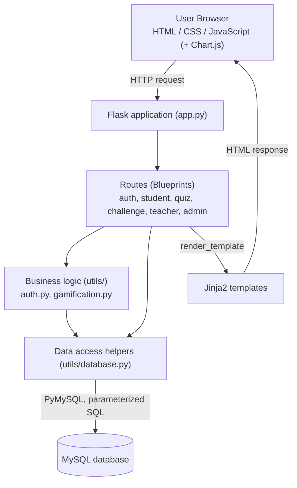
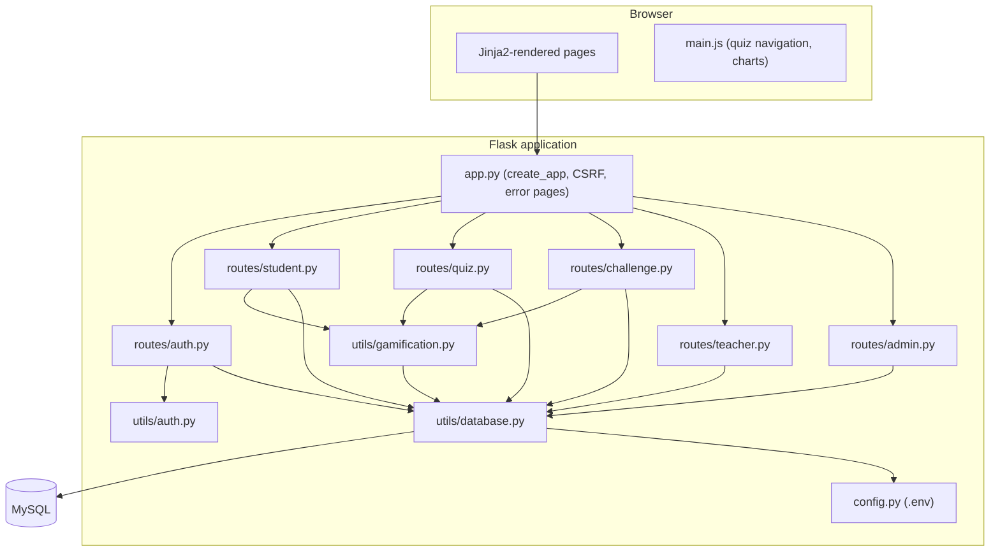
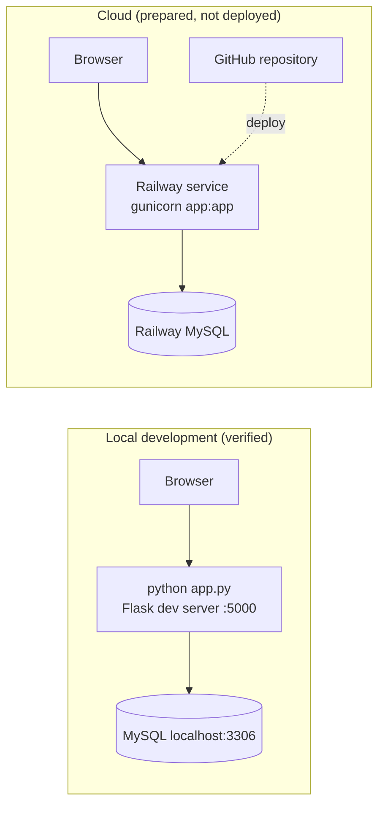

# System Architecture

EcoQuest uses a simple **three-tier architecture**.

| Layer | Technology | Where in the project |
|---|---|---|
| Presentation | HTML5, CSS3, vanilla JavaScript, Chart.js | `templates/`, `static/` |
| Application | Python, Flask | `app.py`, `routes/`, `utils/` |
| Data | MySQL (PyMySQL driver) | `database/schema.sql`, `utils/database.py` |

## Request flow (example: completing a lesson)

1. The browser sends `POST /student/lessons/1/complete` with the session cookie and CSRF token.
2. `check_csrf` (before-request hook) validates the token; `@login_required("student")` checks the session role.
3. The route inserts a row into `user_progress`, then calls `record_activity()` in `utils/gamification.py`.
4. `record_activity()` adds XP, writes `activity_log`, updates the streak and awards any newly satisfied badges.
5. The route commits the transaction and redirects with flash messages (XP and badge notifications).

## Component diagram

## Deployment diagram

Local development (verified) and the intended cloud layout (prepared, **not deployed or verified**):

## Roles and access control

| Role | Can open | Enforced by |
|---|---|---|
| Student | `/student/*`, `/quiz/*`, `/challenges/*` | `@login_required("student")` |
| Teacher | `/teacher/*`, leaderboard, profile | `@login_required("teacher")` |
| Admin | `/admin/*` and also all `/teacher/*` pages | `@login_required("admin")`; admin passes teacher checks |

The decorator in `utils/auth.py` reads `session["role"]` (set at login from the database) and redirects unauthorised users.

## Security measures actually implemented

* Passwords hashed with Werkzeug (`generate_password_hash`).
* Server-side sessions via a signed cookie (`HttpOnly`, `SameSite=Lax`; `Secure` configurable by env var).
* Role-based authorisation on every protected route.
* Parameterised SQL everywhere (`%s` placeholders) — no string-formatted user input in queries.
* CSRF token on every POST form.
* Jinja2 auto-escaping of all output (prevents XSS from user-entered text).
* Quiz answers are graded on the server; correct answers are never sent to the browser while taking a quiz.
* Secrets and DB credentials come from environment variables (`.env`, not committed).

These are practical project-level protections; the application has not had an independent security audit.
