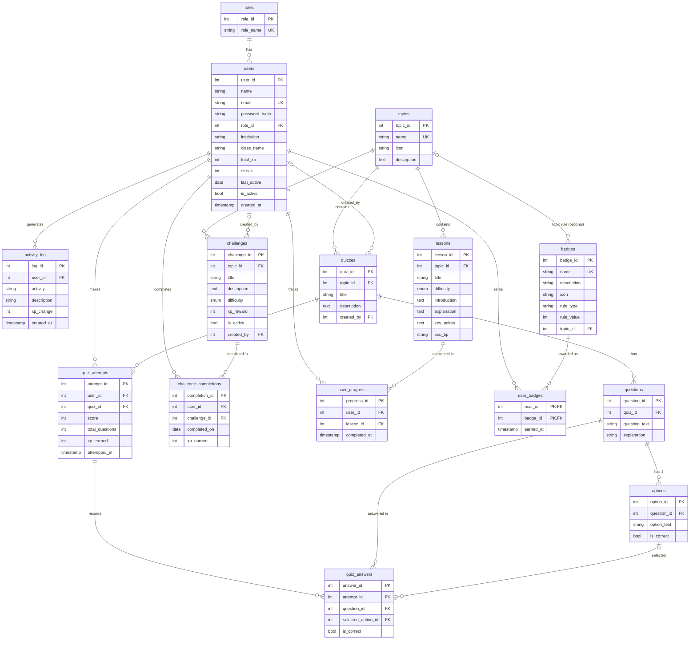

# Database Design (MySQL 8, InnoDB)

The authoritative definition is [`database/schema.sql`](../database/schema.sql). This document and the ER diagram match it.
Demo content is loaded by `init_db.py` from `database/seed_data.py` (Python was chosen over a raw `seed.sql` so that demo
passwords can be hashed with the same code the application uses).

## ER Diagram



## Relationships (cardinality)

| Relationship | Cardinality | Implemented by |
|---|---|---|
| Role – User | 1:N | `users.role_id` |
| User – QuizAttempt | 1:N | `quiz_attempts.user_id` |
| Quiz – Question | 1:N | `questions.quiz_id` |
| Question – Option | 1:N (4 per question, 1 correct) | `options.question_id` |
| Topic – Lesson / Quiz / Challenge | 1:N | `lessons/quizzes/challenges.topic_id` |
| User – ChallengeCompletion – Challenge | 1:N each | `challenge_completions` |
| User – Badge | N:M | `user_badges` (composite primary key) |
| User – Lesson (progress) | N:M | `user_progress` (unique user+lesson) |

## Constraints worth knowing

* `users.email` UNIQUE; passwords stored only as Werkzeug hashes (`password_hash`).
* `challenge_completions` UNIQUE(`user_id`,`challenge_id`,`completed_on`): a challenge can be completed once per student per day.
* `user_progress` UNIQUE(`user_id`,`lesson_id`): a lesson can be completed once.
* `user_badges` PRIMARY KEY(`user_id`,`badge_id`): a badge can be earned once.
* Foreign keys use `ON DELETE CASCADE` for dependent data (e.g. deleting a topic removes its lessons, quizzes, questions, options)
  and `ON DELETE SET NULL` for optional links (`created_by`, `selected_option_id`).
* Indexes: on foreign keys used in joins and on `users.total_xp` (leaderboard sort).

## Normalization

* **1NF** – every column holds a single value. Exception chosen deliberately: `lessons.key_points` stores several
  short bullet points as newline-separated text, because they are only ever displayed together (a separate table would add
  complexity without benefit for this project).
* **2NF / 3NF** – every non-key column depends on the whole key and only on the key: roles are in their own table, quiz
  data is split into quiz → question → option, completions are in separate tables. `users.total_xp` and `users.streak` are
  deliberate **denormalised, derived values** kept for fast leaderboard queries (the history in `activity_log` records each change).

## Badge rule types (`badges.rule_type`)

| rule_type | Meaning |
|---|---|
| `lessons` | number of lessons completed ≥ rule_value |
| `quizzes` | number of quiz attempts ≥ rule_value |
| `topic_challenges` | challenges completed in `topic_id` ≥ rule_value |
| `topic_activity` | lessons + challenges completed in `topic_id` ≥ rule_value |
| `streak` | current streak ≥ rule_value |
| `xp` | total XP ≥ rule_value |

## Example queries used by the application

```sql
-- Leaderboard (SQL sorting)
SELECT u.name, u.total_xp FROM users u JOIN roles r ON u.role_id = r.role_id
WHERE r.role_name = 'student' ORDER BY u.total_xp DESC;

-- Average score per quiz (teacher dashboard)
SELECT q.title, ROUND(AVG(a.score * 100 / a.total_questions)) AS avg_pct
FROM quizzes q LEFT JOIN quiz_attempts a ON q.quiz_id = a.quiz_id GROUP BY q.quiz_id, q.title;
```
