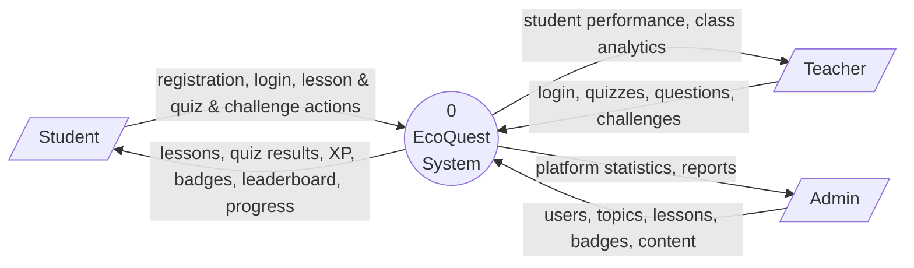
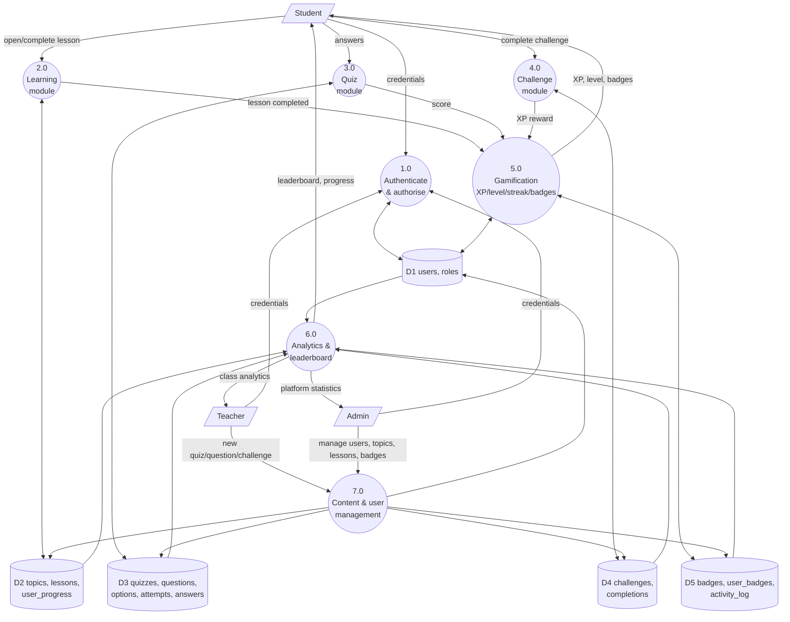
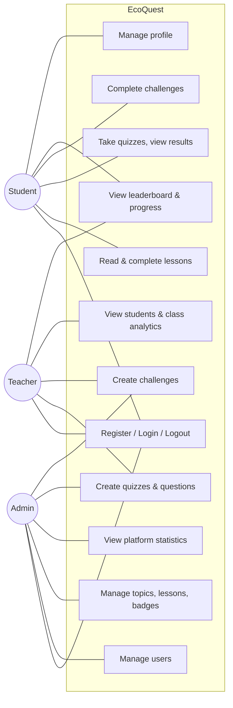
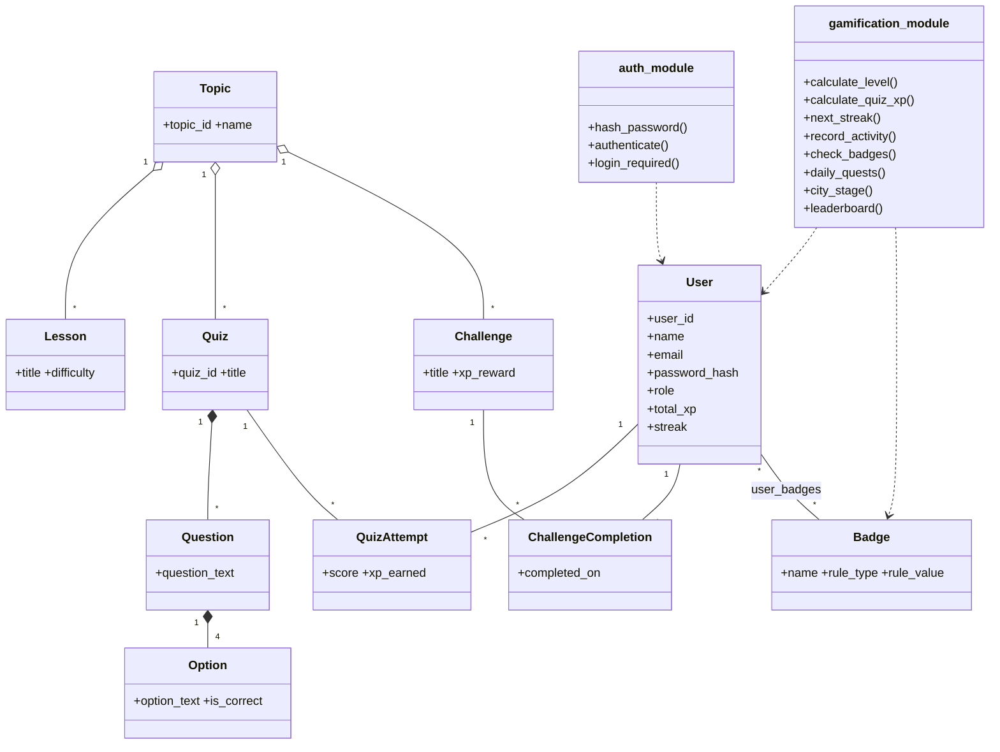
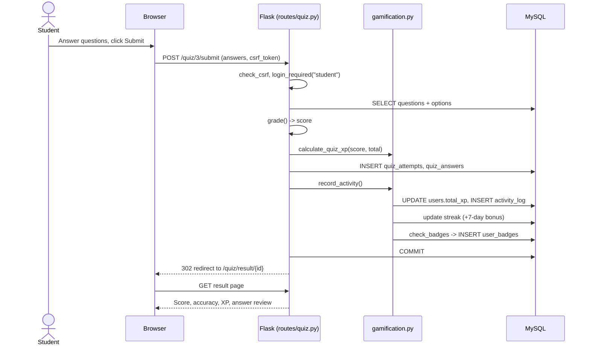
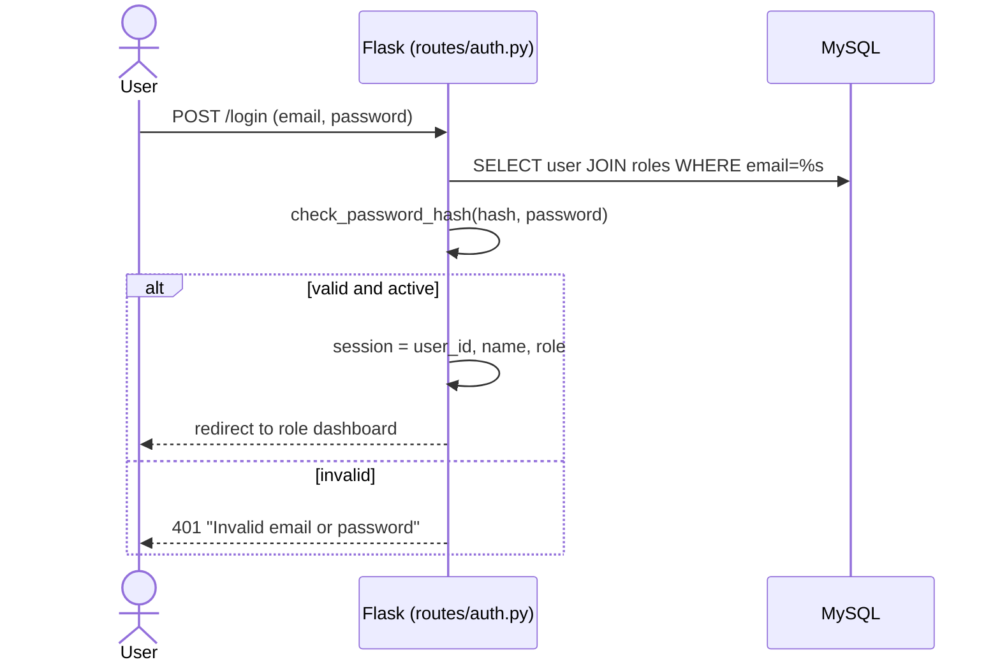
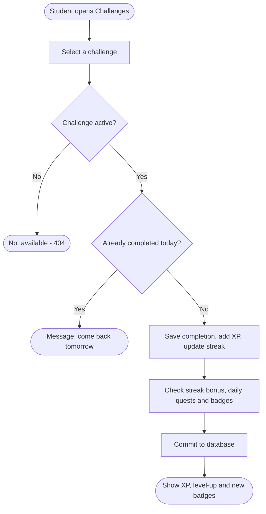

# UML and Data Flow Diagrams

All diagrams are written in Mermaid (rendered automatically by GitHub and VS Code Markdown preview) and describe only
features that exist in the implemented application.

## DFD Level 0 (context diagram)

## DFD Level 1

## Use case diagram

## Class diagram

The implementation uses a modular, function-based style (Flask blueprints and helper modules) rather than custom Python
classes, so the class diagram shows the **domain entities** (which map one-to-one to database tables) and the modules that
operate on them.

## Sequence diagram — submitting a quiz

## Sequence diagram — login

## Activity diagram — completing an eco challenge

